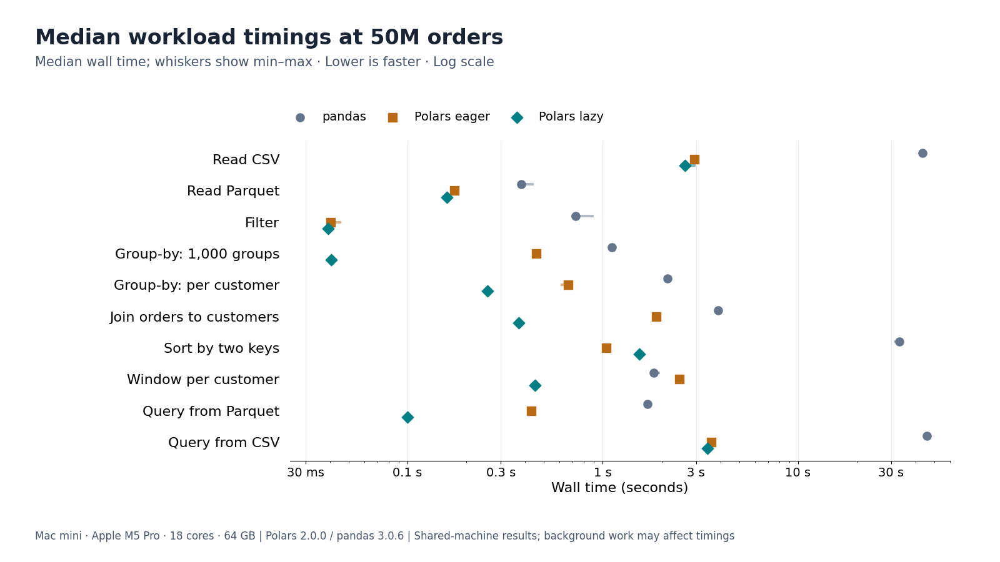
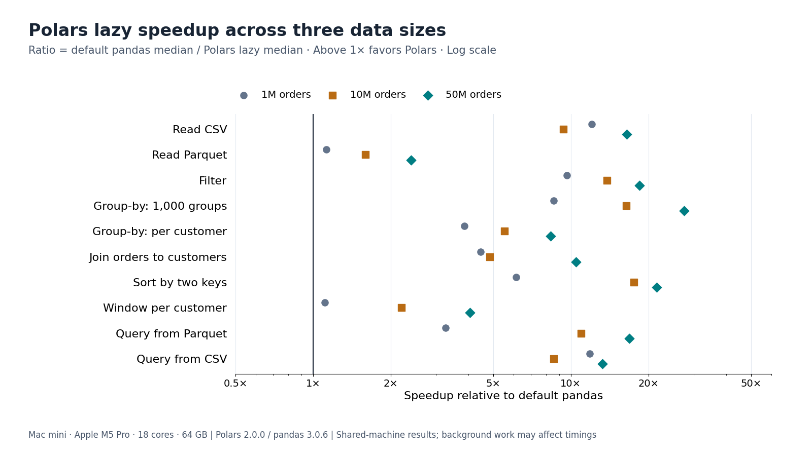
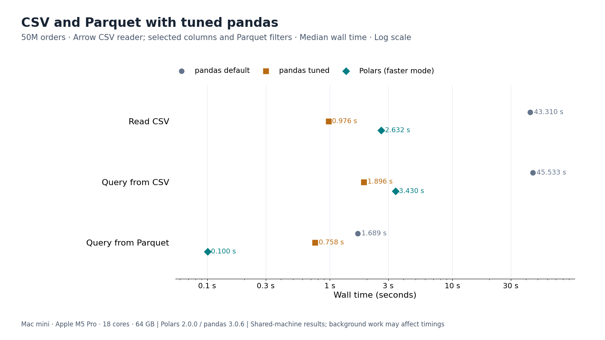
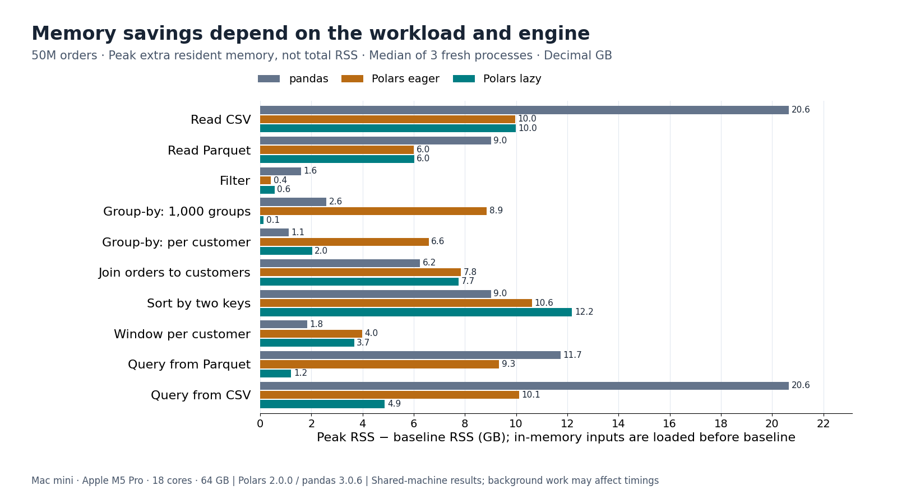
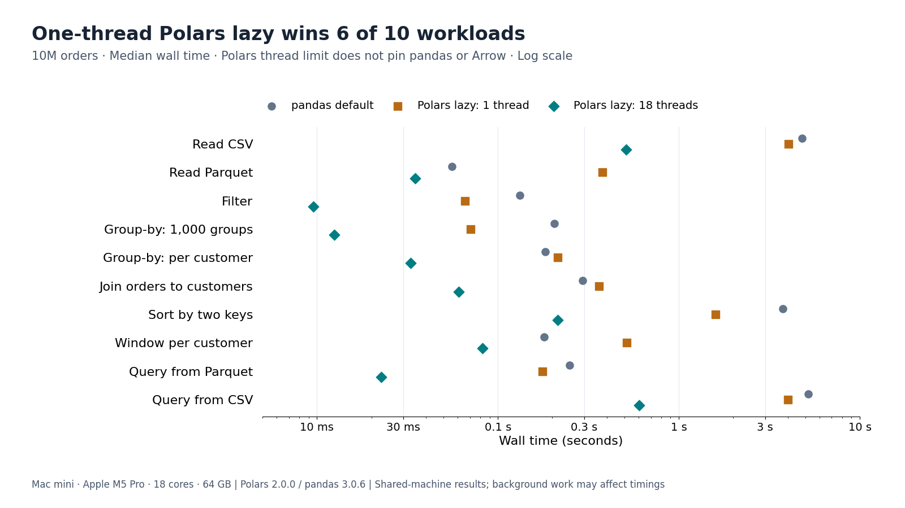
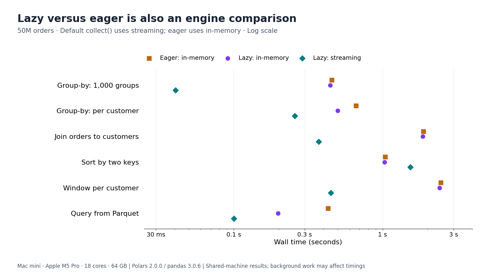

# polars-vs-pandas-bench

A reproducible, single-machine comparison of **Polars 2.0.0 and pandas 3.0.6**,
with source code, the original Mac measurements, and standalone PNG/SVG charts.

## Abstract

On this Mac, Polars lazy with its default streaming engine had a lower median
wall time than default pandas on all ten workloads at 50 million orders:
**2.4×–27.4× faster**. This is not a universal ranking. Polars eager lost the
window workload, and pandas using its PyArrow CSV reader beat Polars on both
CSV reading and the CSV query. Memory results also vary by workload.

**The Mac was busy with other work.** The timing harness gated and retried
batches, but four retained batches exceeded its background-load threshold.
These are the original results, not a new quiet-machine run or adjusted estimates.



## 1. Scope and provenance

The question is how these exact versions compare on common tabular workloads,
not whether Polars 2.0 is faster than Polars 1.x. Measurements were collected
on October 7, 2026, one day after the Polars `py-2.0.0` release.

The published files in [`results/`](results/) came from the original benchmark.
The timing, memory and CSV records, validation fingerprints, console log and
summary values are preserved. The only privacy redaction removes the absolute
interpreter path from `environment.json`; no timing or measurement was changed.
[`results/PROVENANCE.md`](results/PROVENANCE.md) records checksums and source adaptations.
The release text is retained with [third-party attribution](THIRD_PARTY_NOTICES.md).

## 2. Environment

| Component | Recorded configuration |
|---|---|
| Machine | Mac mini, Mac17,16 |
| CPU | Apple M5 Pro, 18 cores: 6 Super and 12 Performance |
| RAM | 64 GB |
| OS / architecture | macOS 27.0.1 / arm64 |
| Python | CPython 3.14.8 |
| Polars | 2.0.0, rt32 runtime, UInt32 index |
| pandas | 3.0.6 |
| PyArrow / NumPy / psutil | 25.0.1 / 2.5.3 / 7.2.2 |
| Polars threads / engine affinity | 18 / auto |
| Power | AC power, low-power mode off |

Exact package pins live in [`scripts/requirements.txt`](scripts/requirements.txt).
Chart rendering uses a separate pinned Matplotlib dependency.
See [`results/environment.json`](results/environment.json) for the hardware summary.
No serial number, hostname or user home directory is published.

## 3. Data and workloads

### 3.1 Seeded synthetic data

[`gen_data.py`](scripts/gen_data.py) uses NumPy's generator with seed
`20261007 + number_of_orders`. Each size is generated independently.
The orders table has 1M, 10M or 50M rows and ten columns:

- `order_id`: sequential Int64; `ts`: sorted, second-resolution timestamps in 2025, stored as microsecond datetimes.
- `customer_id`: uniform keys over N/10 customers; `product_id`: uniform over 50,000 products.
- `store`: 200 string keys; `channel`: web/app/store/phone with probabilities 45/30/20/5%.
- `status`: delivered/shipped/pending/cancelled/returned with probabilities 62/18/8/7/5%.
- `quantity`: integer 1–10; `unit_price`: rounded lognormal distribution, parameters 3.2 and 0.9.
- `discount`: 0/5/10/20% with probabilities 60/20/15/5%, plus 5% independently missing values.

The customers table has N/10 rows, unique customer IDs, three segments,
30 countries and signup dates from a seven-year span beginning in 2018.
The same Polars-written CSV and Parquet files feed every mode. Parquet uses
Polars defaults (Zstandard compression and column statistics).
The original 50M orders CSV was approximately 3.91 GB and its Parquet file
approximately 0.77 GB. The generated dataset is **not committed**; the seeded
generator rebuilds it. Allow at least 10 GB free disk space for all sizes and
substantial free RAM: some 50M measurements added over 20 GB of resident memory.

### 3.2 Workload definitions

| Workload | Work performed |
|---|---|
| Read CSV | Read all orders, including timestamp parsing |
| Read Parquet | Read all orders and columns |
| Filter | Delivered, unit price > 50, channel web or app |
| Group-by, 1,000 groups | Store × status; revenue sum, discount mean, order count |
| Group-by, per customer | Customer ID; revenue sum, order count, latest timestamp |
| Join | Inner join of orders to the unique customers table |
| Sort | Full orders sorted by customer ID then timestamp |
| Window | Price minus customer mean; cumulative quantity in input order per customer |
| Query from Parquet | Read, filter delivered orders in Q4, join, net revenue, aggregate country × segment, descending revenue |
| Query from CSV | Same query, beginning with CSV files |

Net revenue in the queries is `quantity * unit_price * (1 - discount.fill_null(0))`.
The six in-memory workloads start after both tables are loaded from Parquet;
loading is excluded from timing. File reads and queries include I/O and return
materialized results, not unevaluated lazy plans.

### 3.3 Modes and tuning

1. **pandas**: defaults, NumPy-backed numerical columns, pandas 3 Arrow-backed strings;
   `groupby(sort=False)`; no categoricals or Arrow dtype backend.
2. **Polars eager**: DataFrame API, in-memory engine.
3. **Polars lazy**: LazyFrame/scan plus `collect()` with no engine override;
   the default resolves to streaming in the tested Polars 2.0.0 runtime.
4. **Polars lazy in-memory**: same lazy expressions with `collect(engine="in-memory")`.

Three additional pandas cases use its PyArrow CSV reader, select only needed
query columns, and push predicates into the Parquet reader. They are reported
separately rather than substituted for the default pandas baseline.
The source definitions are in [`ops.py`](scripts/ops.py).

## 4. Measurement method

### Timing

- Each size/mode runs in a fresh process; workloads within that process share loaded inputs.
- At 1M: two warm-ups, then ten timed runs. At 10M: one warm-up, seven timed runs.
  At 50M: one warm-up, five timed runs. One-thread cases at 10M use one warm-up and five timed runs.
- Garbage collection precedes each run and is excluded. Wall time uses `perf_counter()`;
  process CPU time uses `getrusage()` across threads. CPU/wall is a diagnostic average of cores busy.
- Results show medians and spread, not the best run. Ratios divide median pandas time by median Polars time.
  Quartiles use inclusive interpolation; min–max whiskers are **not confidence intervals**.
- Repeated reads are warm-cache workloads. There is no cache flush or claim to SSD throughput.

### Background-work controls

Before each workload batch the harness samples background CPU for two seconds,
waiting for at most 2.5 other cores busy. It proceeds after a 20-minute timeout
regardless. A timed run lasting at least one second is retried when background
load exceeds three cores, with at most three individual retries per batch.
A batch totalling at least one second is retried if its average exceeds three
cores, up to three attempts. The final attempt may be retained with a flag.
Sub-second batches cannot reliably measure background load with these counters.

The saved summary contains **1,046 accepted timed records**, and **132 rejected
records, including 18 warm-ups**. The median reported background load across
measurable timing cells was 1.40 cores; the maximum was 10.95 cores.
Four retained cells were flagged:

- 10M pandas PyArrow CSV read.
- 10M Polars lazy in-memory sort.
- 50M Polars eager low-cardinality group-by.
- 50M Polars lazy join.

The CSV side probe waits at the same gate but does **not** apply the timing
harness's retry/filtering rules. Its eager timestamp-parsing case recorded
8.15 background cores at the median. The memory run also had other work
running; it has no quiet-machine gate. Do not interpret these controls as
isolating the desktop completely.

### Memory

Each cell has three fresh child processes at 10M and 50M. The parent samples
child RSS approximately every millisecond, records the maximum and subtracts
the child's pre-operation baseline. For in-memory workloads both tables are
already loaded at baseline; for file-based workloads neither is loaded.
The charts report the median **extra** RSS in decimal GB, not total process
memory. Library-reported input size covers the orders table only.
Kernel high-water deltas are retained as a secondary metric. They can include
pre-operation peaks and are not a ground-truth incremental allocation count.

### Correctness

The original `validation_1M.json` reports agreement in all four modes and the
three tuned pandas cases at 1M rows. It compares row counts, selected aggregate
fingerprints, sort checks and query outputs, with float tolerances of relative
`1e-9` and absolute `1e-6`. **Fingerprints are not exhaustive row-by-row equality.**
The repository's tests additionally compare complete outputs on a small seeded
10,000-order fixture, including nulls and window ordering. Date/timestamp
representations are normalized before comparing logical values. The validator now exits nonzero
on disagreement, so the rerun script stops rather than timing mismatched answers.

## 5. Results

### 5.1 Median wall times at 50M orders

All times below are seconds. `Lazy speedup` is default pandas / Polars lazy.

| Workload | pandas | Polars eager | Polars lazy | Lazy speedup |
|---|---:|---:|---:|---:|
| Read CSV | 43.310 | 2.946 | 2.632 | 16.45× |
| Read Parquet | 0.382 | 0.173 | 0.159 | 2.40× |
| Filter | 0.724 | 0.040 | 0.039 | 18.47× |
| Group-by, 1,000 groups | 1.112 | 0.455 | 0.041 | 27.45× |
| Group-by, per customer | 2.149 | 0.663 | 0.257 | 8.35× |
| Join | 3.903 | 1.884 | 0.372 | 10.48× |
| Sort | 33.103 | 1.040 | 1.534 | 21.58× |
| Window | 1.822 | 2.465 | 0.449 | 4.05× |
| Query from Parquet | 1.689 | 0.431 | 0.100 | 16.84× |
| Query from CSV | 45.533 | 3.590 | 3.430 | 13.27× |

Default lazy ratios range from 2.40× (Parquet read) to 27.45× (low-cardinality
group-by). The eager window takes 2.465 s versus pandas' 1.822 s. Eager sorting
is faster than lazy sorting, 1.040 s versus 1.534 s. In the saved 50M default
cells, IQR/median reaches approximately 15% and is typically about 3%.
See [`summary.md`](results/summary.md) for all sizes, four modes, spread and CPU diagnostics.

### 5.2 Scaling

Lazy's 50M speedup exceeds its 1M speedup on every workload, but the trend is
not monotonic: both CSV workloads have smaller speedups at 10M than at 1M.
At 1M the window and Parquet read are near ties; seven default pandas workloads
take under 50 ms. Small-data overhead matters.



### 5.3 Tuned pandas and CSV readers

At 50M, pandas' PyArrow CSV read takes **0.976 s** against **2.632 s** for
Polars lazy. The tuned CSV query takes **1.896 s** against **3.430 s**.
For the Parquet query, tuned pandas takes **0.758 s** versus **0.100 s** for
Polars lazy, a 7.56× difference.



The separate CSV probe suggests timestamp parsing contributes substantially:
Polars with timestamps left as text takes 0.959 s, with an explicit timestamp
type 2.438 s, and an Arrow table converted to Polars 0.884 s.
These variants do not all return the same representation; the text-only case
omits parsing work and is not an equivalent typed read. The probe's pandas
Arrow case is 0.889 s, not the main timing's 0.976 s. Do not mix the two runs
or attribute the entire gap causally to timestamp parsing.
See [`csv_probe.jsonl`](results/csv_probe.jsonl) for its five timed samples per variant.

### 5.4 Peak extra memory

For the Parquet query, Polars lazy grows by **1.2 GB**, default pandas by
**11.7 GB**, and tuned pandas by **2.4 GB**. Lazy's low-cardinality group-by
grows by about **0.14 GB**, versus eager's **8.9 GB** and pandas' **2.6 GB**.
pandas uses less extra RSS than lazy for the per-customer group-by, join,
sort and window. There is no universal memory winner.



### 5.5 One-thread experiment

At 10M, one-thread Polars lazy beats default pandas on **6 of all 10 workloads**;
it loses the Parquet read, high-cardinality group-by, join and window.
Moving Polars from one to 18 threads improves its lazy median times by
**5.6×–10.8×** over all ten workloads. `POLARS_MAX_THREADS=1` only limits
Polars: it does not pin pandas or PyArrow, CPU affinity, or the OS scheduler.
In particular the Parquet comparison includes Arrow's own threading.

The earlier answer displayed eight of these workloads and correctly counted
five wins within that subset, with 5.6×–7.9× thread gains. This write-up displays
all ten saved measurements, including Parquet read and CSV query.



### 5.6 Engine and query-planning effects

Lazy in-memory and eager times are within 2% on the low-cardinality group-by,
join and window at 50M. Streaming is faster there. For the Parquet query,
eager takes 0.431 s, lazy in-memory 0.199 s, and lazy streaming 0.100 s.
This is evidence that both engine choice and query planning matter for these
queries; it is not a controlled measure of the effect of the Polars 2.0 release.



## 6. Interpretation and limitations

- One machine, one day, synthetic mostly uniform keys, and a shared desktop.
  Skewed keys, string cardinality, larger-than-memory data and different hardware can change the ranking.
- Four batches stayed above the gate threshold. Smaller runs, retry limits and
  heterogeneous CPU cores leave scheduling and contention uncertainty.
- Lazy queries can push filters/projections into readers; default pandas eagerly
  loads inputs. The tuned cases clarify some of this difference, not every possible optimization.
- Polars joins/group-bys need not preserve output row order; pandas' merge
  preserves left order. That semantic difference can entail extra work.
- Warm-cache reads measure parsing/decoding/materialization, not cold storage speed.
- RSS sampling can miss short peaks and allocator reuse. Subtracting an already
  loaded baseline is not the same as measuring total memory needed to run the query.
- There is no Polars 1.x comparison, Linux measurement, Arrow dtype-backend pandas
  run, 64-bit-index Polars run, confidence interval or statistical significance claim.

**Conclusion:** for these data and this machine, lazy streaming Polars is a strong
default, particularly for low-cardinality aggregation and optimized Parquet queries.
API mode, reader settings, memory needs and available cores can change that choice.
The raw records support the specific measured ratios, not a blanket library ranking.

## 7. Reproduce it

Run from the project root. The harness supports macOS and Linux; the published
measurements are macOS only. Linux support is not evidence of a Linux result.
Use an isolated environment; do not install globally:

```sh
python3 -m venv .bootstrap
.bootstrap/bin/pip install uv==0.12.23
export UV_PYTHON_INSTALL_DIR="$PWD/.uv-python" UV_CACHE_DIR="$PWD/.uv-cache"
.bootstrap/bin/uv venv --python 3.14.8 .venv
.bootstrap/bin/uv pip install --python .venv/bin/python \
  -r scripts/requirements.txt -r scripts/requirements-charts.txt
```

### Regenerate only the published slides

No generated dataset or benchmark rerun is necessary:

```sh
.venv/bin/python scripts/render_charts.py
```

This reads `results/summary.json` (and its adjacent hardware metadata) and writes
six 1600×900, white-background PNGs plus scalable, self-contained SVGs into
`charts/`. Every plotted number comes from `summary.json`. Names, formats,
units and descriptions are listed in [`charts/README.md`](charts/README.md).
Do not omit the shared-machine caveat when presenting them.

### Quick functional rerun

```sh
.venv/bin/python -m unittest discover -s tests -v
./scripts/run_all.sh --smoke
```

The smoke run generates 1M orders, checks fingerprints, runs one sample of all
43 size/mode/workload combinations, samples memory once per combination, runs
the CSV probe, and creates a summary. It **does not** produce performance-quality
measurements or the three-size slide set. It takes a few minutes plus quiet-gate waits.

### Full benchmark

```sh
./scripts/run_all.sh
```

The full method uses 1M/10M/50M sizes, warm-ups and repeated timings, one-thread
10M runs, three memory repetitions at 10M/50M, the CSV side probe, analysis and
chart rendering. The original main run took about an hour, much of it waiting
for other jobs; the CSV probe ran afterward. Rerun duration and RAM needs vary.

New results go to a new ignored `runs/<timestamp>/` folder; generated tables go
to ignored `data/`. The script refuses nonempty result folders and the published
`results/` folder. It reuses data only when all four files for a size exist.
Individual harnesses append, so always give a fresh results folder when starting
a new experiment. Do not pool separate machines or invocations silently.

```sh
BENCH_DATA_DIR="$PWD/data" BENCH_RESULTS_DIR="$PWD/runs/my-run" ./scripts/run_all.sh
.venv/bin/python scripts/analyze.py --results-dir runs/my-run
.venv/bin/python scripts/render_charts.py \
  --summary runs/my-run/summary.json --output runs/my-run/charts
```

`BENCH_PYTHON` can select an already prepared Python environment. The source
also includes `svgplot.py` and `gen_card.py`, the historical HTML answer renderer;
the formal write-up and standalone charts above are the maintained publication.

## 8. Project contents and license

- [`scripts/`](scripts/): seeded generator, workload definitions, validation,
  timing/memory harnesses, CSV probe, environment capture, analysis and chart renderers.
- [`results/`](results/): original raw records, summary tables, correctness fingerprints,
  environment, run log, provenance and release notes.
- [`charts/`](charts/): PNG/SVG pairs, manifest and slide captions.
- [`tests/`](tests/): full-output checks, summary/renderer checks and rerun safety checks.

MIT licensed; see [`LICENSE`](LICENSE) and third-party notices.
The local project is ready for publication. Creating the public repository
`Pikaryu729/polars-vs-pandas-bench` and pushing it is a separate step after merging
this work. No public repository or upload is claimed here.
